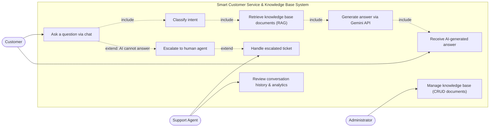
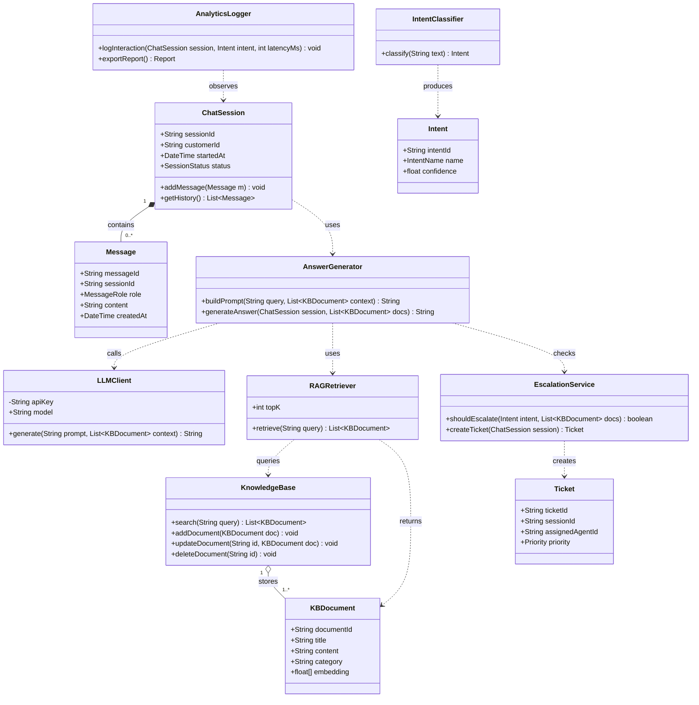
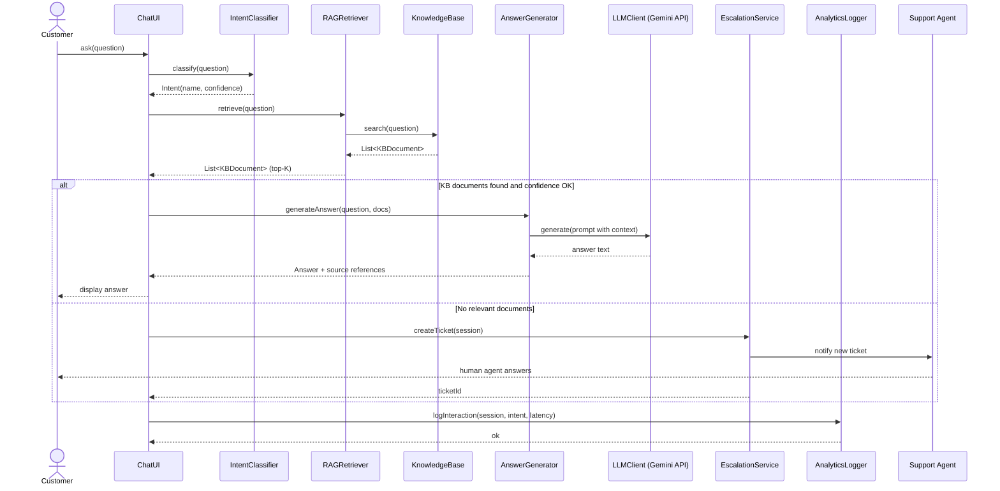
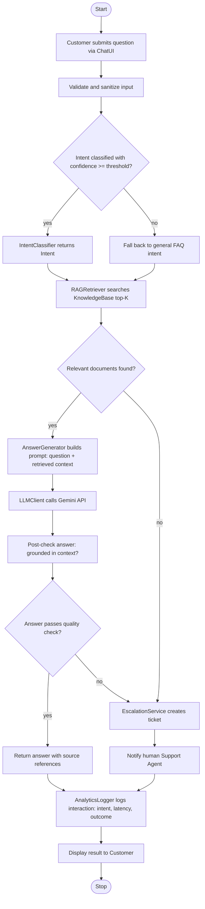
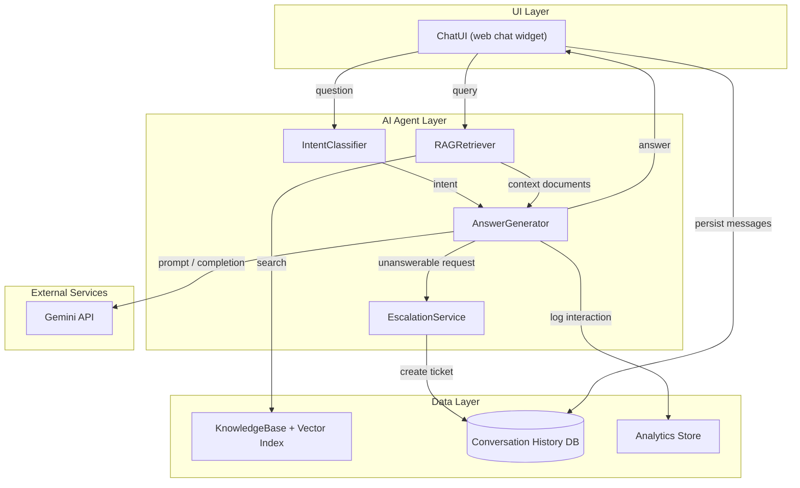

# Išmanioji klientų aptarnavimo ir žinių bazės sistema — „Mermaid“ diagramos

Šis failas — 1.1 užduoties dalis: „PlantUML“ diagramos perdarytos į **Mermaid** formatą,
kad būtų atvaizduojamos tiesiogiai „GitHub“ platformoje. Semantika ir vardai išlaikyti tie patys
kaip ir `docs/plantuml/` versijoje (kodas anglų kalba, paaiškinimai lietuviški).

## 1. Naudojimo atvejų diagrama (use case → flowchart)

Aktorius („Customer“) užduoda klausimą ir gauna DI sugeneruotą atsakymą;
sistemos viduje vykdomas ketinimo klasifikavimas, RAG paieška ir atsakymo generavimas
per „Gemini API“. Administratorius prižiūri žinių bazę, o klientų aptarnavimo specialistas
sprendžia eskaluotas užklausas.

## 2. Klasių diagrama (classDiagram)

Pagrindiniai dalykinės srities objektai (`ChatSession`, `Message`) ir DI agento komponentai
(`IntentClassifier`, `RAGRetriever`, `AnswerGenerator`, `LLMClient`) su ryšiais:
pokalbio seansas turi daug žinučių, RAG paieškos modulis pateikia užklausą žinių bazei, atsakymų
generatorius kviečia „Gemini API“ ir tikrina eskalacijos taisykles.

## 3. Sekų diagrama (sequenceDiagram)

Pilno ciklo (angl. *End-to-End*) eiga: kliento klausimas → ketinimo klasifikavimas → RAG paieška
žinių bazėje → atsakymo generavimas per „Gemini API“ → atsakymo pateikimas.
Jei žinių bazėje tinkamų dokumentų nerandama, vykdoma eskalacija žmogaus operatoriui
(`alt` fragmentas). Kiekviena sąveika užregistruojama analitikos žurnale.

## 4. Veiklos diagrama (activity → flowchart)

Užklausos apdorojimo eiga su trimis sprendimo taškais: (a) ar ketinimas
klasifikuotas pakankamai tiksliai, (b) ar žinių bazėje rasti tinkami
dokumentai, (c) ar sugeneruotas atsakymas praeina kokybės patikrą.
Neigiamu atveju — eskalacija ir pranešimas klientų aptarnavimo specialistui.

## 5. Komponentų diagrama (component → flowchart su sluoksniais)

Sistemos sluoksniai: naudotojo sąsaja (pokalbių langas), DI agento sluoksnis
(ketinimų klasifikatorius, RAG paieškos modulis, atsakymų generatorius, eskalacijų
tarnyba), duomenų sluoksnis (žinių bazė su vektoriniu indeksu, pokalbių
istorija, analitikos saugykla) ir išorinės paslaugos („Gemini API“).

